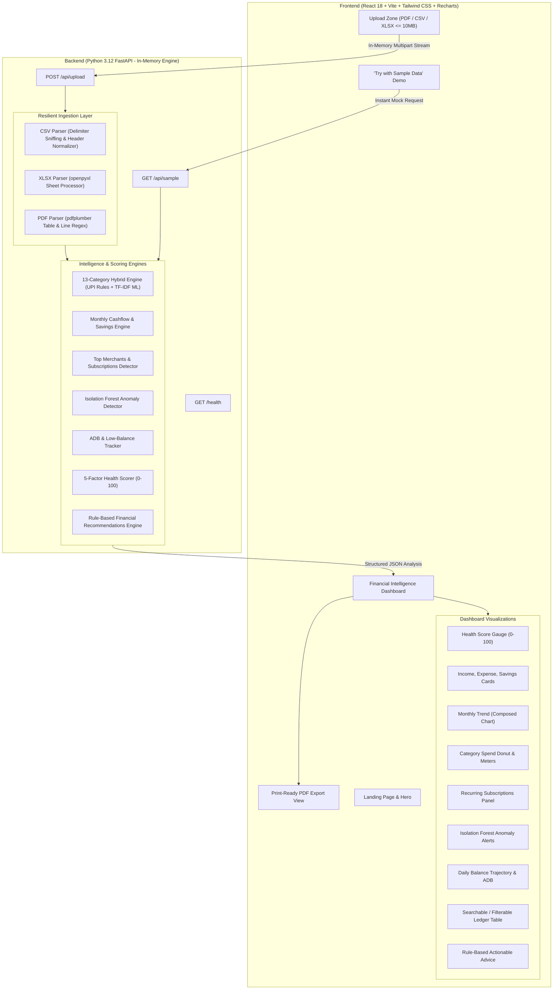
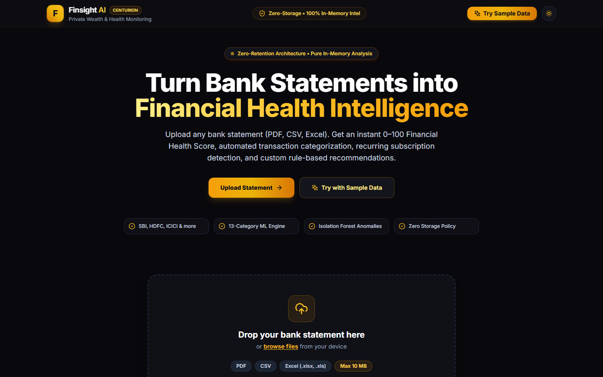
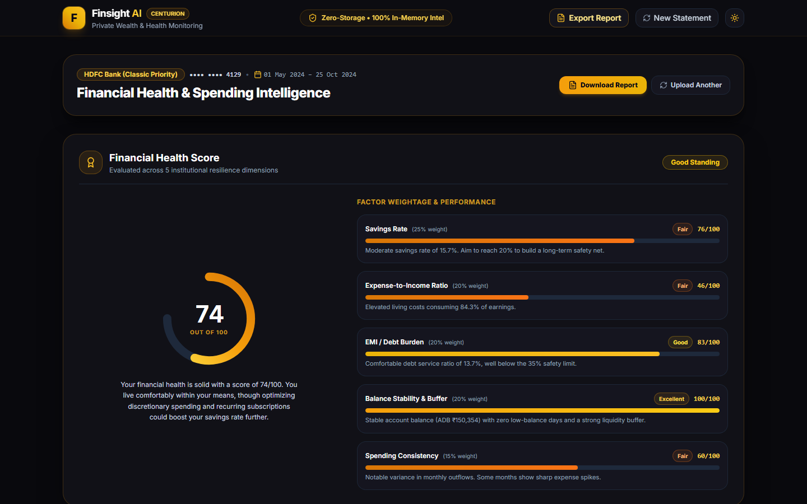
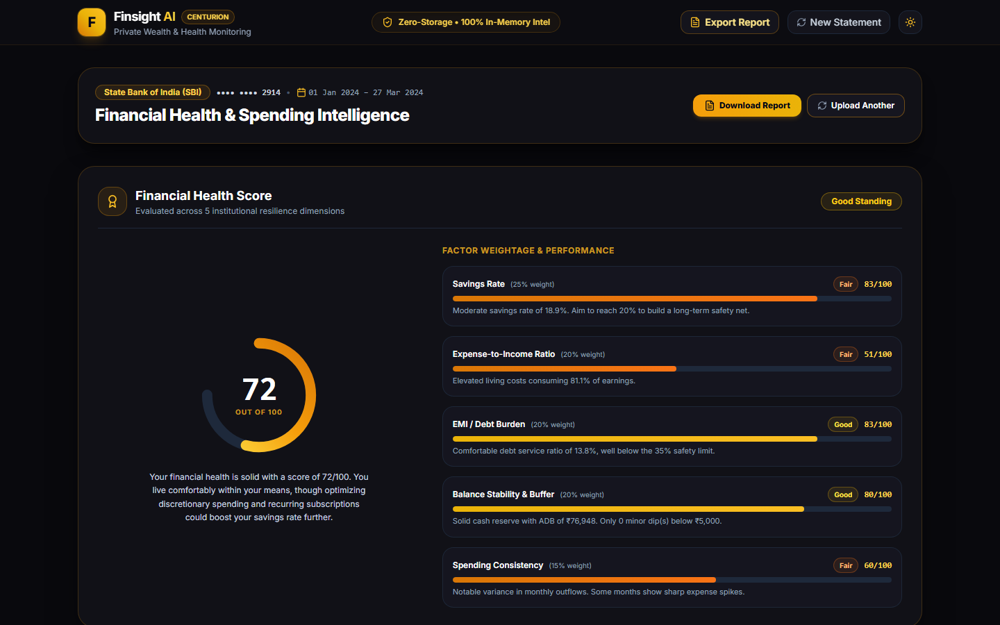
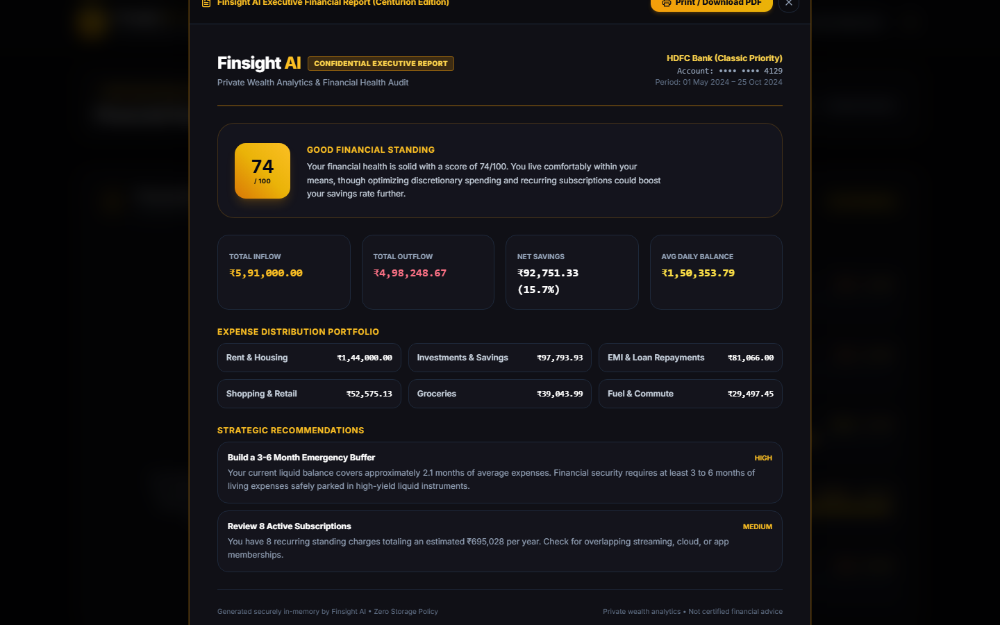

# Finsight AI 💸
### Bank Statement Analysis & Financial Health Monitoring Engine

[](https://fastapi.tiangolo.com)
[](https://reactjs.org)
[](https://tailwindcss.com)
[](#aesthetic-design)
[](#privacy--security-by-design)
[](https://opensource.org/licenses/MIT)

---

## 📌 Problem Statement

Managing personal finances often feels overwhelming because raw bank statements are cluttered with cryptic merchant codes, unstructured UPI IDs, and disjointed debit/credit rows. Most people cannot readily determine:
- Where their money actually went across discretionary vs non-discretionary sectors.
- Whether recurring subscriptions or standing mandates are draining their balance silently.
- Whether an objective metric exists for their overall financial health.

Commercial aggregators often require permanent access to bank accounts and store transaction data in persistent databases, raising significant privacy and security concerns.

**Finsight AI** solves this problem by providing **instant, privacy-first financial intelligence**. Users simply drop a bank statement in PDF, CSV, or Excel format (up to 10 MB). The statement is processed **purely in volatile memory** (zero database storage), producing a 0–100 Financial Health Score, automated categorization across 13 sectors, anomaly detection via Isolation Forest, recurring subscription detection, and custom rule-based savings recommendations.

---

## 🚀 Key Features

1. **Multi-Format Ingestion (PDF, CSV, XLSX)**
   - Resilient parsing supporting Indian banking formats (SBI, HDFC, ICICI, Canara, Axis, PNB, etc.) and international standard statements.
   - Automatic delimiter sniffing (`,`, `;`, `\t`, `|`) and day-first date format normalizer (`DD/MM/YYYY`, `DD-Mon-YYYY`, `YYYY-MM-DD`).
   - Line-by-line regex fallback for tableless bank statement PDFs.

2. **Automated 13-Category Transaction Intelligence**
   - High-precision rule engine decomposing Indian UPI IDs (`@okhdfcbank`, `@paytm`, `@okaxis`, `@apl`).
   - Categorizes into: `salary_income`, `food`, `groceries`, `rent`, `transport`, `shopping`, `bills_utilities`, `emi_loans`, `upi_transfers`, `entertainment`, `health`, `education`, `investments`, and `other`.
   - Built-in Scikit-Learn TF-IDF + Multinomial Naive Bayes fallback classifier for unmapped merchant strings.

3. **Objective 5-Factor Financial Health Score (0–100)**
   - **Savings Rate (25%)**: Evaluates surplus income ratio against the 20%+ benchmark.
   - **Expense-to-Income Ratio (20%)**: Assesses living cost sustainability (&le;50% is optimal).
   - **EMI & Debt Burden (20%)**: Flags debt distress when installment servicing exceeds 35% of earnings.
   - **Balance Stability & Buffer (20%)**: Evaluates Average Daily Balance (ADB) against monthly burn and counts low-balance dips (<₹5,000).
   - **Spending Consistency (15%)**: Measures month-over-month variance to detect volatility.
   - Provides per-factor score breakdown, qualitative tier (*Excellent*, *Good*, *Fair*, *Needs Attention*), and plain-language explanation.

4. **Anomaly & Outlier Detection**
   - Machine learning anomaly detection using `scikit-learn` Isolation Forest (`[amount, log_amount, day_of_month]`) combined with statistical category z-score triggers.
   - Explains reason and severity for each flagged transaction.

5. **Recurring Payment & Subscription Radar**
   - Detects standing charges and subscription cadences (monthly, weekly, bi-weekly) for Netflix, Spotify, broadband, rent, and loan EMIs.
   - Projects estimated annual commitments.

6. **Searchable, Sortable, Filterable Ledger**
   - Instant search across descriptions and clean merchant names.
   - Filter by category and transaction type (Debit vs Credit).
   - Sort by date, amount, category, or closing balance with pagination.

7. **Executive Print-Friendly Report**
   - 1-Click "Download PDF" view formatted with clean `@media print` styling for board or accountant presentation.

8. **Privacy-First & Secure by Design**
   - Zero-retention architecture: Statements are parsed strictly inside volatile memory buffers (`io.BytesIO`) and discarded immediately.
   - Account numbers masked to `•••• •••• 1234`.
   - Security headers (HSTS, CSP, X-Frame-Options) and IP rate-limiting via SlowAPI.

---

## 🏗 System Architecture



---

## 📸 Screenshots & UI Walkthrough

| Landing Page & Upload Zone | Financial Health Score & Dashboard |
| :---: | :---: |
|  |  |

| SBI CSV Upload Analysis | Printable Executive Report |
| :---: | :---: |
|  |  |

---

## 📂 Project Directory Structure

```
finsight-ai/
├── backend/
│   ├── app/
│   │   ├── api/
│   │   │   └── routes.py             # /upload, /sample, /health endpoints
│   │   ├── models/
│   │   │   └── schemas.py            # Pydantic data contracts
│   │   ├── parsers/
│   │   │   ├── base.py               # Date/amount normalizer & bank heuristics
│   │   │   ├── csv_parser.py         # CSV reader with delimiter sniffing
│   │   │   ├── xlsx_parser.py        # Excel openpyxl parser
│   │   │   └── pdf_parser.py         # pdfplumber table & regex parser
│   │   ├── categorization/
│   │   │   ├── keywords.py           # 13 category rules & UPI patterns
│   │   │   └── engine.py             # Rule engine + TF-IDF ML fallback
│   │   ├── analytics/
│   │   │   ├── cashflow.py           # Monthly income, burn, runway
│   │   │   ├── merchants.py          # Top spenders & subscription detector
│   │   │   ├── anomalies.py          # Isolation Forest anomaly scoring
│   │   │   ├── balances.py           # Daily balance & ADB calculator
│   │   │   └── pipeline.py           # Full analytics orchestrator
│   │   ├── scoring/
│   │   │   └── health_engine.py      # 5-factor scoring algorithm (0-100)
│   │   ├── recommendations/
│   │   │   └── rule_engine.py        # Actionable financial advice rules
│   │   ├── samples/
│   │   │   └── generator.py          # 6-month realistic Indian statement generator
│   │   ├── config.py                 # App limits & CORS settings
│   │   └── main.py                   # FastAPI app, security headers, rate limiting
│   ├── tests/
│   │   ├── test_parsers.py           # CSV, XLSX, PDF parser tests
│   │   ├── test_categorization.py    # Category & UPI tests
│   │   ├── test_scoring.py           # 5-factor scoring tests
│   │   └── test_api.py               # Endpoint integration tests
│   ├── requirements.txt
│   ├── render.yaml                   # Render deployment blueprint
│   └── .env.example
├── frontend/
│   ├── src/
│   │   ├── components/
│   │   │   ├── Navbar.jsx            # Top navigation & theme toggle
│   │   │   ├── Hero.jsx              # Landing hero & value proposition
│   │   │   ├── HowItWorks.jsx        # 3-step pipeline cards
│   │   │   ├── PrivacyNotice.jsx     # In-memory zero-retention guarantee
│   │   │   ├── UploadZone.jsx        # Drag-and-drop file upload zone
│   │   │   ├── HealthScoreGauge.jsx  # SVG speedometer & factor breakdown
│   │   │   ├── SummaryCards.jsx      # Income, expense, savings cards
│   │   │   ├── MonthlyTrendChart.jsx # Recharts cashflow trend
│   │   │   ├── CategoryBreakdown.jsx # Recharts donut & category meters
│   │   │   ├── MerchantsAndSubscriptions.jsx # Subscriptions & top spenders
│   │   │   ├── AnomalyAlerts.jsx     # Isolation Forest alert cards
│   │   │   ├── BalanceTimelineChart.jsx # Daily balance line & ADB line
│   │   │   ├── RecommendationsPanel.jsx # Actionable advice cards
│   │   │   ├── TransactionsTable.jsx # Searchable, sortable ledger
│   │   │   └── ReportModal.jsx       # Printable executive report view
│   │   ├── services/
│   │   │   └── api.js                # API client with error handling
│   │   ├── utils/
│   │   │   └── formatters.js         # Currency (₹ INR / $ USD) & date helpers
│   │   ├── App.jsx                   # Application state orchestrator
│   │   ├── index.css                 # Tailwind directives & print styles
│   │   └── main.jsx
│   ├── package.json
│   ├── vite.config.js
│   ├── tailwind.config.js
│   ├── postcss.config.js
│   ├── vercel.json                   # Vercel SPA routing & security headers
│   └── .env.example
├── samples/
│   ├── sample_statement_sbi.csv      # Ready-to-upload SBI statement
│   ├── sample_statement_hdfc.xlsx    # Ready-to-upload HDFC spreadsheet
│   ├── sample_statement_icici.csv    # Ready-to-upload ICICI statement
│   └── sample_statement_canara.pdf   # Ready-to-upload Canara PDF statement
├── screenshots/                      # Browser verification screenshots
└── README.md
```

---

## 🛠 Local Setup & Installation

### Prerequisites
- Python 3.10+ (tested on Python 3.12)
- Node.js 18+ & npm

### 1. Clone the repository
```bash
git clone https://github.com/<your-username>/finsight-ai.git
cd finsight-ai
```

### 2. Backend Setup
```bash
cd backend
python -m venv venv

# Activate Virtual Environment:
# On Windows (PowerShell):
.\venv\Scripts\Activate.ps1
# On macOS/Linux:
source venv/bin/activate

# Install dependencies:
pip install -r requirements.txt

# Run Unit & Integration Tests:
pytest -v

# Start the Backend Server:
uvicorn app.main:app --host 127.0.0.1 --port 8000 --reload
```
The FastAPI server will be active at `http://127.0.0.1:8000` with interactive docs at `http://127.0.0.1:8000/docs`.

### 3. Frontend Setup
Open a separate terminal window:
```bash
cd frontend

# Install dependencies:
npm install

# Start development server:
npm run dev
```
Open `http://localhost:5173` in your browser.

---

## 🚀 Public Deployment Guide

### A. Deploy Backend to Render

1. Create a free account at [render.com](https://render.com).
2. Connect your GitHub repository.
3. Choose **Blueprint** deployment (Render will automatically detect `backend/render.yaml`) OR create a new **Web Service** with:
   - **Root Directory**: `backend`
   - **Environment**: `Python 3`
   - **Build Command**: `pip install -r requirements.txt`
   - **Start Command**: `uvicorn app.main:app --host 0.0.0.0 --port $PORT`
   - **Health Check Path**: `/health`
4. Set Environment Variables in Render Dashboard:
   - `CORS_ORIGINS`: `https://finsight-ai.vercel.app,http://localhost:5173,*`
   - `RATE_LIMIT_UPLOAD`: `30/minute`
5. Note your deployed Render URL (e.g. `https://finsight-ai-backend.onrender.com`).

### B. Deploy Frontend to Vercel

1. Create a free account at [vercel.com](https://vercel.com).
2. Click **Add New Project** and import your `finsight-ai` repository.
3. Configure project settings:
   - **Framework Preset**: `Vite`
   - **Root Directory**: `frontend`
   - **Build Command**: `npm run build`
   - **Output Directory**: `dist`
4. Add Environment Variable:
   - `VITE_API_BASE_URL`: `https://finsight-ai-backend.onrender.com` (your Render backend URL)
5. Deploy! Vercel will build the frontend and serve it with the included `vercel.json` SPA rewrites and security headers.

---

## 📤 Push to GitHub (Commands)

To publish this project to your own public GitHub repository:

```bash
# Initialize git repository
git init

# Add all project files
git add .

# Create initial commit
git commit -m "feat: initial commit of Finsight AI bank statement intelligence platform"

# Link to your GitHub repository
git branch -M main
git remote add origin https://github.com/<your-username>/finsight-ai.git

# Push to GitHub
git push -u origin main
```

---

## 📄 License

This project is open-source and released under the [MIT License](https://opensource.org/licenses/MIT).
